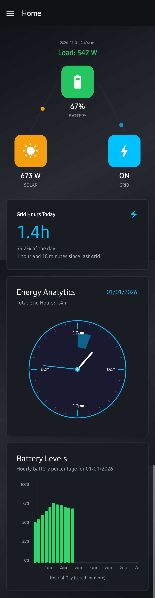
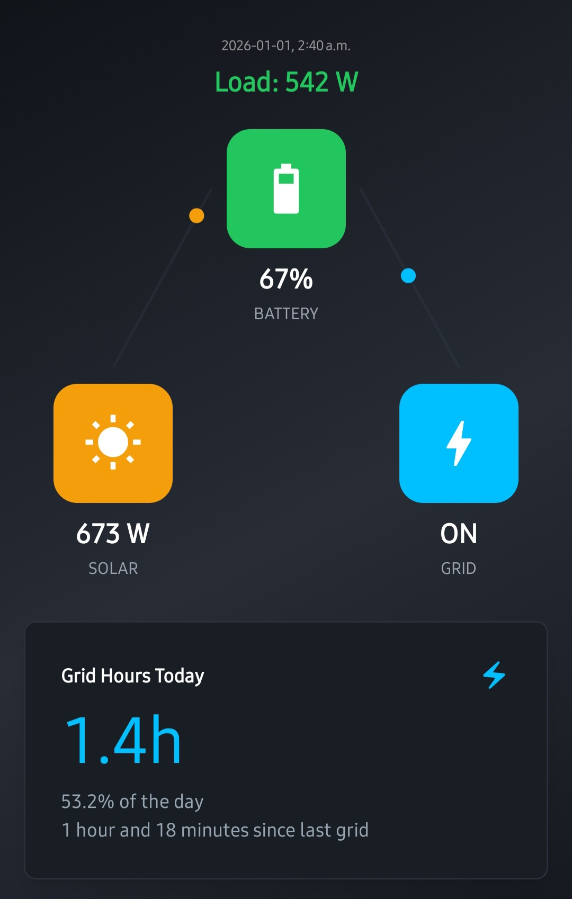
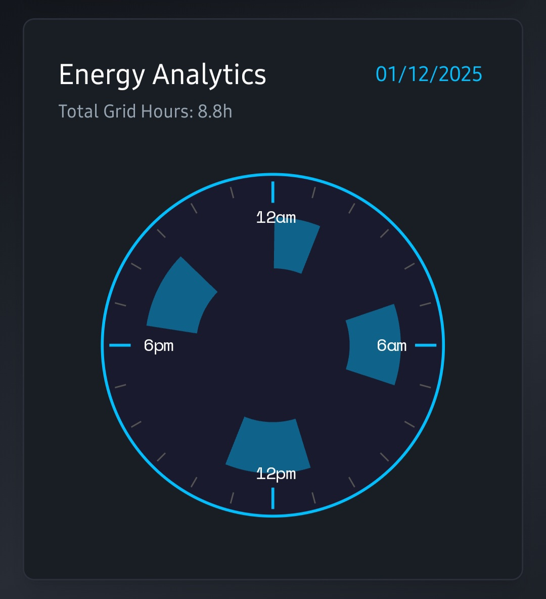
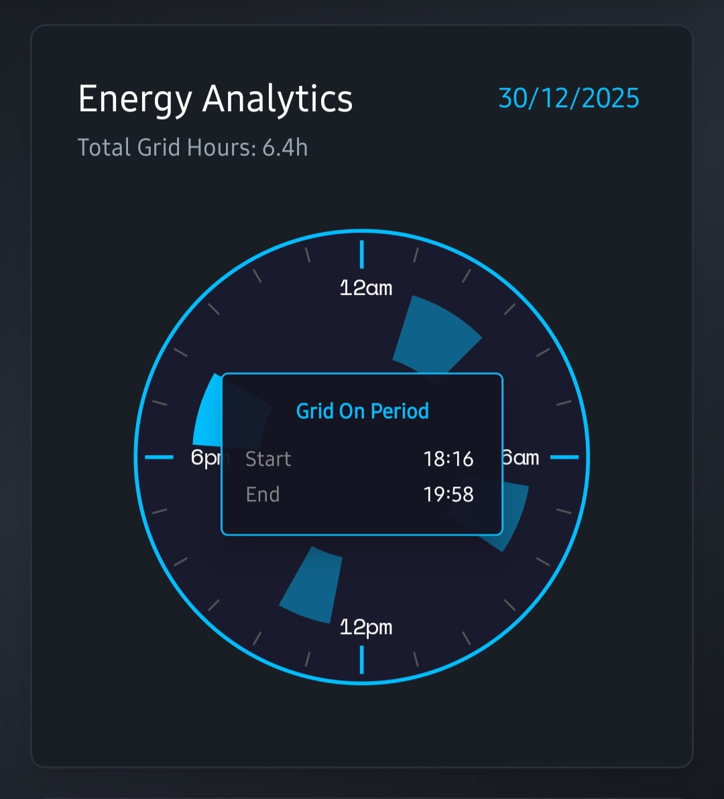
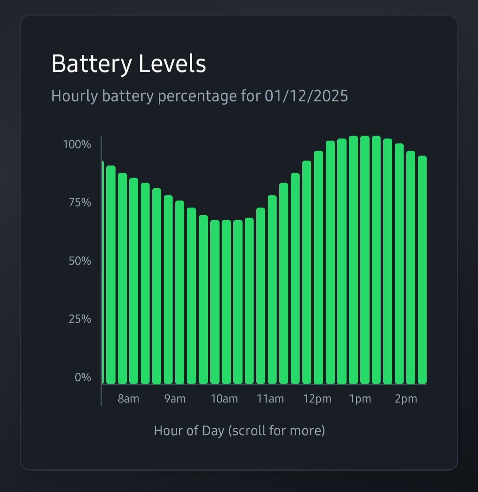
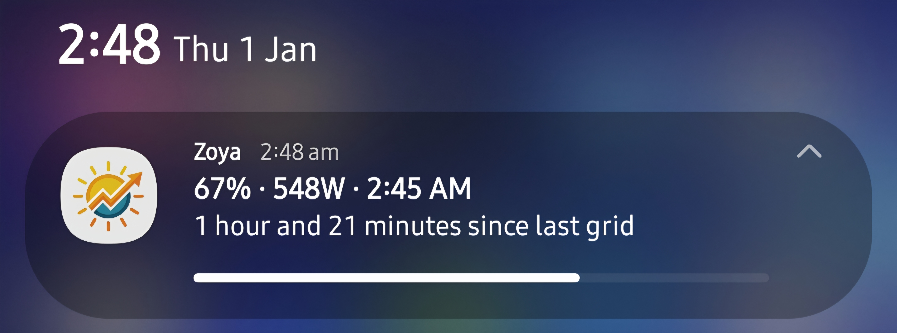
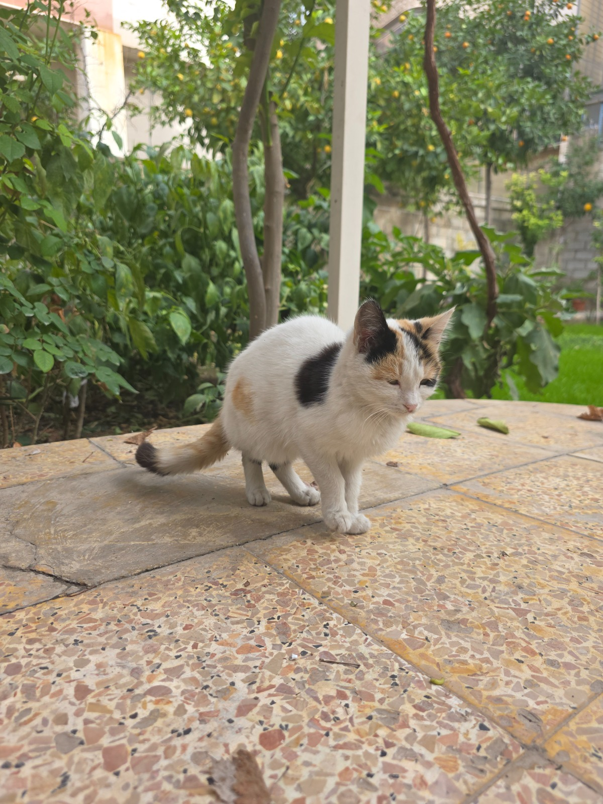

# Zoya ☀️

 
 

  
Click to see the full user interface

  

    
  

## What is this 
> Excuse the unpolished code. I've never worked with React Native and this project is half vibe coded!

If you're unlucky enough to live in a country with barely any electricity and have a solar system installed. Zoya is an app that helps you track your battery level, usage, and grid hours.
 

## Featuers
- Clean UI that displays the current status of the battery (charging, wattage and grid status), how many hours the grid was on for the current day and when it was last on.
  
- 24 hour clock that highlights the periods when the grid was on.
  
  
- Battery level chart that displays the battery percentage throughout the day.
  
- Live notification that fetches and displays useful information in real time.
  

## How to use 
This app relies on the WatchPower API used by the [WatchPower Android App](https://play.google.com/store/apps/details?id=wifiapp.volfw.watchpower&hl=en). I'm not a 100% sure which inverters work with this app but I think most of the ones made by Voltronic should work fine.
 
**Basically, any inverter that works with the WatchPower app will work with this app!**
- This app DOES NOT support signups, you need to download the Watchpower [Android](https://play.google.com/store/apps/details?id=wifiapp.volfw.watchpower&hl=en) or [IOS](https://play.google.com/store/apps/details?id=wifiapp.volfw.watchpower&hl=en) App, create a new account and configure your inverter and connect it to your WiFi!
- Download and install the Zoya App, and login with your WatchPower credentials.
- The app will fetch all of your devices and list them in the side drawer and will always launch and display the data for the first device by default!
- Enjoy!

## Enabling the battery status live notification
To enable battery status live notification you can go to settings and flick the "Battery notification" switch.
 
As of right now, the notification will only display the status of the first device that you have associated with your account. This is a limtiation that I may or may not fix in the future!
 
 
The notification will refresh its data **every ~2.5 minutes**. The interval heavily depends on when Android decides to allow the foreground service to run.
**For best results, you need to disable battery optimizations for the app in the settings!**

## Who is Zoya
This app was named after a very lovely and special cat.
 
Zoya was a lovely street cat who lived in our small garden along with 10 other cats that we feed and take care of.
She got infected with Feline Panleukopenia (I think) and passed away within a few days.

  
Expand to see pictures of Zoya

  

    
    
    
  

## Credits 
- [davidsmfreire/watchpower-api](https://github.com/davidsmfreire/watchpower-api) for reverse engineering the WatchPower API and making it publicly available!
- [Claude Code](https://claude.ai/) for coding more than half of the app for me (our end is near 😢)
